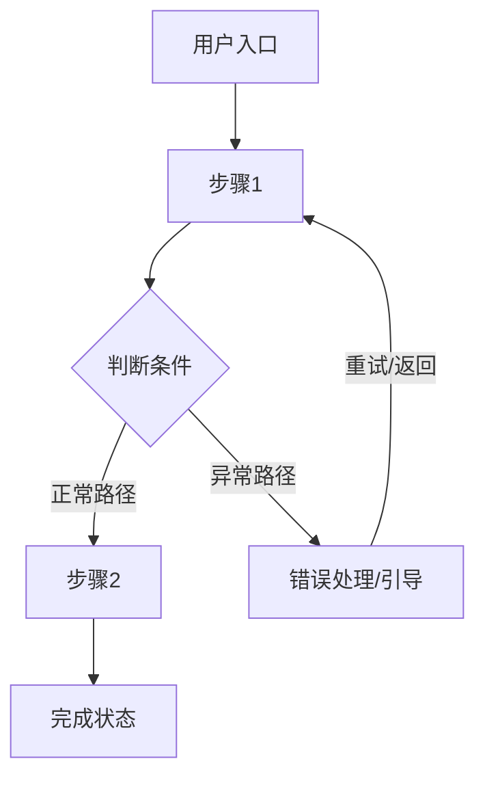

# [产品名称] 产品需求文档 (PRD)

## 1. 产品概述

### 1.1 产品定位
> 这是一个给【目标用户】用的【产品形态】，帮他们【解决什么问题】。
> 与现有方案相比，核心差异是【差异化优势】。

### 1.2 产品形态
- **当前选型**：【网页 Web App / 微信小程序 / 原生 App / AI Skill】
- **选择理由**：
- **阶段策略**：

### 1.3 文档信息

| 字段 | 内容 |
|-----|------|
| 产品名称 | [产品名称] |
| 文档版本 | V1.0 |
| 编写日期 | [YYYY-MM-DD] |
| 最后更新 | [YYYY-MM-DD] |

---

## 2. 目标用户与使用场景

### 2.1 用户画像

| 维度 | 核心用户 | 次要用户 |
|-----|---------|---------|
| 年龄/职业 | | |
| 核心特征 | | |
| 使用频率 | | |
| 技术水平 | | |

### 2.2 典型使用场景

**场景 1：** [谁] 在 [什么情况下]，想要 [做什么]，期望 [什么结果]

**场景 2：** [谁] 在 [什么情况下]，想要 [做什么]，期望 [什么结果]

**场景 3：** [谁] 在 [什么情况下]，想要 [做什么]，期望 [什么结果]

---

## 3. 核心用户动线



> 至少覆盖主流程 + 1-2 个异常分支（失败处理、无权限处理等）

---

## 4. 功能清单

```
产品名称
├── 🔴 模块A（核心，MVP 必须有）
│   ├── 功能1
│   ├── 功能2
│   └── 功能3
├── 🟡 模块B（重要，后续迭代）
│   ├── 功能4
│   └── 功能5
└── ⚪ 模块C（未来规划，暂不实现）
    └── 功能6
```

优先级定义：🔴 P0 核心 / 🟡 P1 重要 / ⚪ P2 规划

---

## 4.1 关键页面布局线框图

> 选取产品中最核心的一个页面，用 ASCII 画出页面骨架。

```
┌──────────────────────────────────────────────────────┐
│  [Logo]   顶部导航栏                                   │
├──────────────────────────────────────────────────────┤
│  主内容区                                              │
│  ← 视觉重心，占据最大面积                              │
├──────────────────────────────────────────────────────┤
│  底部操作栏 / 状态栏                                   │
└──────────────────────────────────────────────────────┘
```

> 线框图要体现：导航方向、区域划分、视觉重心、覆盖层元素

---

## 5. 功能详细描述

### 5.1 [功能名称]

**功能描述**：这个功能解决什么问题，核心逻辑是什么。

**触发条件**：用户在什么情况下进入/触发这个功能。

**交互细节**：

| 场景 | 交互处理方式 |
|------|------------|
| 操作反馈 | 用户触发操作后立即看到什么？（loading / toast / 弹窗 / 骨架屏） |
| 危险操作确认 | 删除/不可逆操作是否需要二次确认？确认文案是什么？ |
| 空状态引导 | 第一次进来没有数据时，看到什么？有没有引导做第一步？ |
| 操作失败引导 | 操作失败时，除了报错，还告诉用户下一步怎么做？ |

**状态清单**：

| 状态 | 触发条件 | UI 表现 | 用户可执行操作 |
|------|---------|---------|-------------|
| 默认 | 页面加载完成 | | |
| 加载中 | 用户触发操作后 | 转圈/骨架屏/进度条 | 不可重复触发 |
| 成功 | 操作完成 | 成功提示 + 更新内容 | |
| 失败 | 接口报错或操作失败 | 红色提示 + 重试选项 | 重试/修改后重试 |
| 禁用 | 无权限或条件不满足 | 灰色 + tooltip 说明原因 | 仅查看 |
| 空状态 | 无数据时 | 空状态插图 + 引导文案 + 按钮 | 引导做第一步 |

**边界条件**：

- 内容为空时：
- 内容超长时（字数上限/文件大小上限）：
- 网络异常或请求超时时：
- 无权限时：
- 并发操作时（多人同时操作同一条数据）：
- 数据格式不符时：

**多种内容类型展示规范**（如涉及）：

| 内容类型 | 展示方式 | 特殊交互 | 加载/失败处理 |
|---------|---------|---------|------------|
| 图片 | 缩略图 + 点击放大 | 支持拖拽排序 | 显示破图占位图 |
| PDF | 图标 + 文件名 + 大小 | 点击预览或下载 | 显示下载失败提示 |
| 链接 | URL 卡片预览 | 点击跳转新标签 | 显示原始 URL |

**数据规范**：

| 字段名 | 数据类型 | 长度/大小限制 | 是否必填 | 默认值 | 格式要求 | 校验规则 |
|------|--------|------------|--------|------|--------|--------|
| | | | | | | |

---

### 5.2 [功能名称]

（同上结构，每个 🔴 核心功能独立一节）

---

## 6. 文案规范

### 6.1 产品整体文案风格

风格选项（选一个）：
- 专业严谨（To B 工具、金融类）
- 亲切友好（To C 消费类）
- 简洁直接（效率工具类）
- 轻松有趣（年轻用户、娱乐类）

### 6.2 面向终端用户的产品文案

| 场景 | 文案内容 | 风格备注 |
|------|---------|---------|
| 页面标题 | | 符合产品风格基调 |
| 空状态标题 + 说明 + 按钮 | | 引导性，不迷茫 |
| 按钮文字 | | 动词开头，简洁 |
| 成功提示 | | 正向反馈 |
| 错误提示 | | 说明原因 + 给出下一步 |
| 加载中提示 | | 让用户知道系统在工作 |
| 危险操作确认弹窗 | | 清楚说明后果 |

**文案原则：**
- 按钮文案：动词开头（✅「开始创建」❌「确认」）
- 错误提示：说明原因 + 下一步操作（✅「文件超过10MB，请压缩后重试」❌「上传失败」）
- 空状态：引导性，给用户行动方向

---

## 7. 非功能性需求

### 7.1 性能要求

| 指标 | 要求 |
|-----|------|
| 页面首屏加载 | ≤ 2s |
| 核心接口响应 | ≤ 500ms |
| 并发用户支持 | ≥ [数量] |

### 7.2 权限控制
- 哪些功能需要登录才能使用
- 是否有角色权限区分（管理员/普通用户/访客）

### 7.3 兼容性

| 维度 | 支持范围 |
|-----|---------|
| 设备 | PC / Tablet / Mobile |
| 浏览器 | Chrome 80+, Safari 13+, Edge 80+ |
| 分辨率 | 1920×1080, 1366×768, 375×667 |

### 7.4 数据安全
- 敏感数据的处理方式（加密存储、传输方式）
- 操作日志记录要求

### 7.5 数据存储
- 数据保留时长
- 存储容量限制

---

## 8. 迭代规划

| 版本 | 包含功能 | 预计上线 |
|-----|---------|---------|
| MVP | [核心功能列表] | [时间] |
| V1.1 | [增强功能列表] | [时间] |
| V2.0 | [完整功能列表] | [时间] |

---

## 9. 待确认问题

- [ ] 问题 1（影响：[哪个功能/模块]）
- [ ] 问题 2（影响：[哪个功能/模块]）

---

*文档结束*
